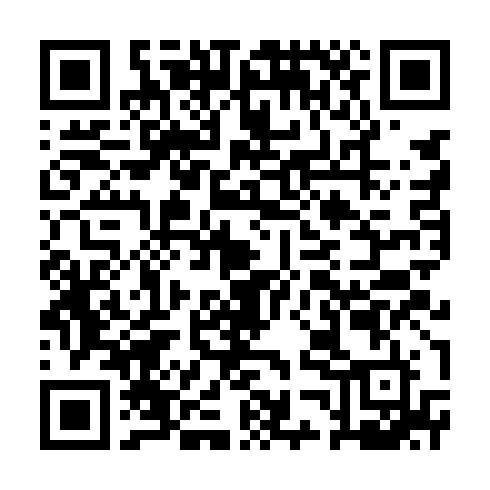

# Поддержка проекта

Mount File распространяется по лицензии MIT. Если проект полезен, добровольный донат помогает оплачивать разработку, тестирование, документацию и поддержку нескольких платформ.

## TON

**Адрес проекта:**

```text
UQCZ10Eh8IJ5sFC6JKn-YralMF45Bk5fkNT6SqTHSIRGxfQv
```

- [Открыть TON-кошелёк](ton://transfer/UQCZ10Eh8IJ5sFC6JKn-YralMF45Bk5fkNT6SqTHSIRGxfQv?text=MountFile%20donation)
- [Проверить адрес в TON Viewer](https://tonviewer.com/UQCZ10Eh8IJ5sFC6JKn-YralMF45Bk5fkNT6SqTHSIRGxfQv)



Сумма не задана: выберите её самостоятельно перед подтверждением транзакции. Перед отправкой сравните адрес в кошельке с адресом выше. Не отправляйте активы из другой сети.

Донат добровольный. Он не является покупкой, инвестицией, обещанием доходности, возврата средств или финансовой услугой. Никому не передавайте seed-фразу, приватный ключ или код подтверждения: для получения доната они не нужны.

## Ссылки

- [Репозиторий Mount File](https://github.com/Alexkkkkk/mount-file)
- [Сообщить об уязвимости](../SECURITY.md)
